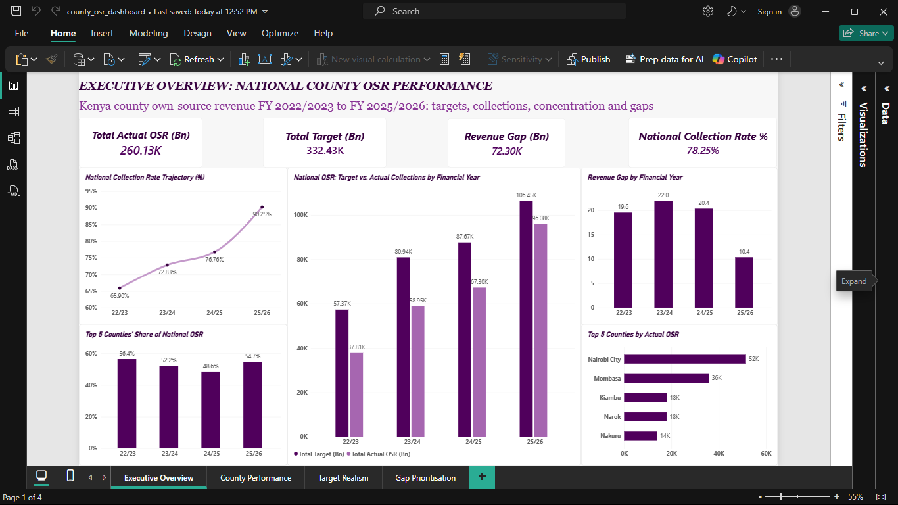
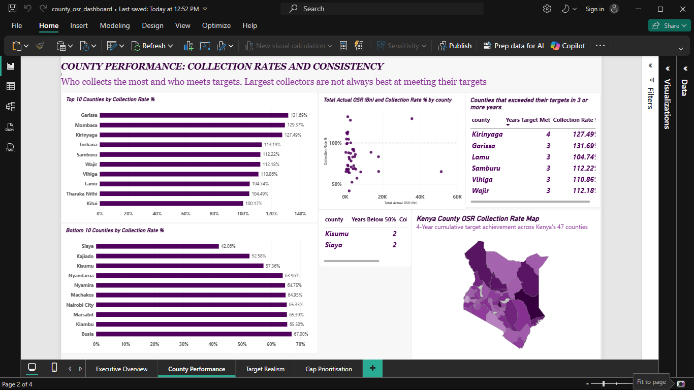
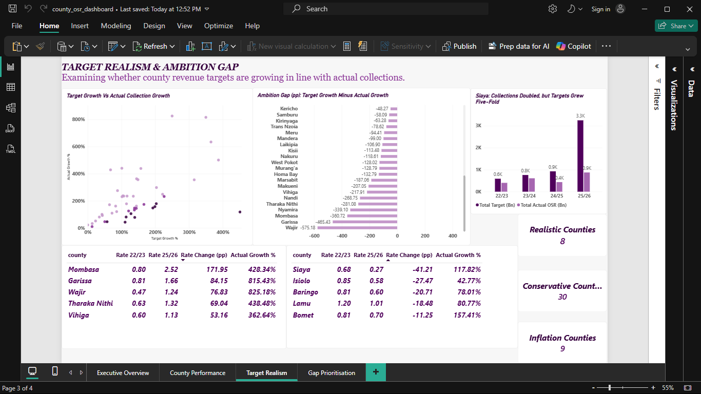
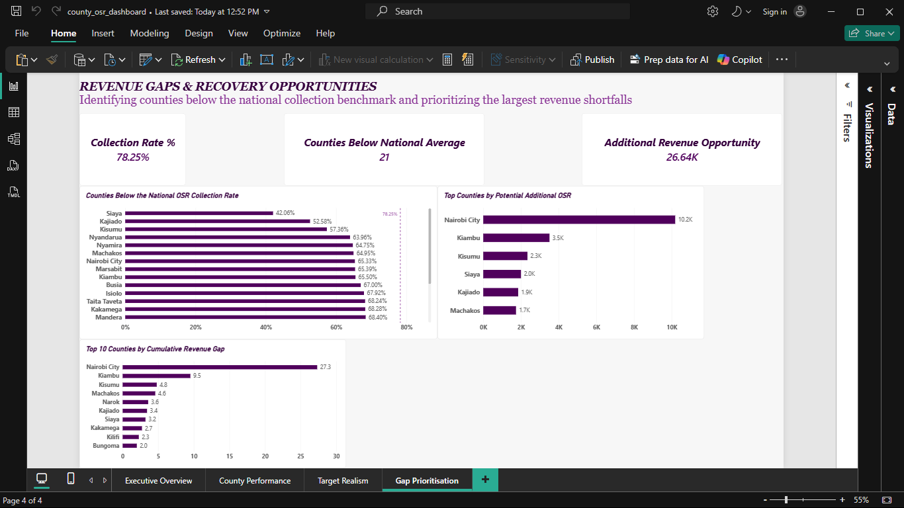

# 🇰🇪 Kenya County Own-Source Revenue Performance Analysis

### SQL & Power BI | FY 2022/23 – FY 2025/26

An end-to-end business intelligence project analyzing revenue collection performance, target achievement, and revenue gaps across Kenya's 47 county governments.

The project uses MySQL for data analysis and Power BI for interactive visualization, with a focus on identifying revenue performance trends, evaluating target realism, and highlighting potential areas for improvement.

---

## 📌 Project Overview

County governments in Kenya generate Own-Source Revenue (OSR) through local revenue streams such as business permits, property rates, parking fees, and market charges.

These collections supplement national government transfers and contribute to financing county operations and service delivery.

However, counties frequently experience differences between their projected revenue targets and actual collections.

This project investigates these differences across **47 counties over four financial years**, examining not only how much revenue counties collected but also how effectively they achieved their targets.

### Main Business Question

**How effectively are Kenyan counties collecting own-source revenue, and where are the greatest opportunities to improve revenue performance and target-setting practices?**

---

## 🎯 Project Objectives

The analysis addresses five key areas:

1. **National Revenue Performance**
   - Evaluate actual OSR collections against revenue targets.
   - Analyze collection rates and revenue gaps over time.
   - Examine the concentration of national OSR among counties.

2. **County Performance**
   - Identify the largest OSR contributors.
   - Rank counties by cumulative collection rates.
   - Compare absolute revenue collection with target achievement.

3. **Performance Consistency**
   - Identify counties that consistently meet revenue targets.
   - Investigate counties experiencing repeated severe shortfalls.

4. **Target Realism**
   - Compare revenue target growth with actual collection growth.
   - Identify counties where targets grew faster than collections.
   - Examine whether declining collection rates necessarily indicate declining revenue.

5. **Revenue Improvement Opportunities**
   - Estimate potential collections if below-average counties reached the national benchmark.
   - Identify counties contributing the largest revenue gaps.
   - Prioritize areas for further investigation.

---

## 🛠️ Tools & Technologies

| Tool | Application |
|------|-------------|
| **MySQL** | Data loading, validation, querying, and business analysis |
| **MySQL Workbench** | SQL development and database management |
| **Power BI** | Interactive dashboard development |
| **DAX** | KPI calculations, collection rates, growth measures, and benchmark analysis |
| **Power Query** | Data preparation and transformation |
| **GitHub** | Project documentation and version control |

### SQL Techniques Used

- Aggregations and grouping
- Conditional aggregation using `CASE WHEN`
- Common Table Expressions (CTEs)
- Self-joins
- Window functions
- Revenue growth calculations
- Ranking and comparative analysis

---

## 📂 Dataset

**Source:** Office of the Controller of Budget (Kenya), with county revenue figures compiled through AfroCave.

**Coverage:**
- 47 Kenyan counties
- 4 financial years
- 188 county-year observations

### Dataset Fields

| Column | Description |
|--------|-------------|
| `financial_year` | Reporting financial year |
| `county` | County name |
| `revenue_target_mn` | Annual OSR target in KSh millions |
| `actual_revenue_mn` | Actual annual OSR collected in KSh millions |

### Key Metrics

**Collection Rate**

`Collection Rate = Actual OSR / Revenue Target × 100`

**Revenue Gap**

`Revenue Gap = Revenue Target − Actual OSR`

**Year-over-Year Revenue Growth**

`YoY Growth = (Current Year Revenue − Previous Year Revenue) / Previous Year Revenue × 100`

**Ambition Gap**

`Ambition Gap = Target Growth (%) − Actual Collection Growth (%)`

The Ambition Gap is expressed in percentage points.

A positive value indicates that targets grew faster than actual collections, while a negative value indicates that actual collections grew faster than targets.

This metric highlights differences in growth trajectories; it does not independently establish whether revenue targets were appropriately set.

---

# 📊 Key Findings

## 1. National OSR Collections Increased Significantly

County own-source revenue increased from **KSh 37.8 billion in FY 2022/23** to **KSh 96.1 billion in FY 2025/26**.

The national collection rate also improved from **65.9% to 90.3%**, with actual collections growing faster than revenue targets in each successive year.

This indicates improving reported target achievement over the period.

## 2. Revenue Gaps Remained Substantial

Despite improving collection rates, the national revenue gap remained close to **KSh 20 billion annually** between FY 2022/23 and FY 2024/25.

The gap subsequently narrowed to approximately **KSh 10.4 billion in FY 2025/26**.

Across all four years, the cumulative difference between revenue targets and actual collections was approximately **KSh 72.3 billion**.

## 3. National OSR Is Concentrated in a Few Counties

The five largest revenue-collecting counties contributed between **48.6% and 56.4%** of national OSR in each financial year.

Nairobi City was the largest cumulative contributor, collecting approximately **KSh 51.5 billion** over the four-year period.

Other major contributors included Mombasa, Kiambu, Narok, and Nakuru.

This concentration indicates that national OSR trends are strongly influenced by a relatively small number of counties.

## 4. High Revenue Collection Does Not Guarantee Strong Target Achievement

Nairobi City collected the highest cumulative OSR at **KSh 51.5 billion**, but achieved only **65.3%** of its combined revenue target.

Mombasa collected approximately **KSh 35.8 billion** and achieved **129.4%** of its cumulative target.

Mombasa therefore combined substantial revenue collections with strong cumulative target achievement.

These findings demonstrate the importance of evaluating both revenue volume and collection rates.

## 5. Kirinyaga Demonstrated the Most Consistent Target Achievement

Kirinyaga was the only county to meet or exceed its annual OSR target in all four financial years.

Garissa, Lamu, Samburu, Vihiga, and Wajir achieved their targets in three of the four years.

This suggests that consistent target achievement is not limited to counties with the largest revenue collections.

## 6. Siaya Recorded the Lowest Cumulative Collection Rate

Siaya collected approximately **KSh 2.33 billion** against a combined four-year target of **KSh 5.53 billion**.

This represented a cumulative collection rate of **42.1%**, the lowest among the 47 counties.

However, Siaya's actual collections increased by **117.8%** between FY 2022/23 and FY 2025/26.

Its declining collection rate therefore reflected revenue targets growing considerably faster than actual collections, rather than a decline in the absolute amount collected.

---

## 💡 7. Target Realism: The Ambition Gap Analysis

One of the central findings of this project is that **growth in actual revenue and improvement in target achievement are not necessarily the same thing**.

The Ambition Gap metric compares growth in revenue targets with growth in actual collections between the first and last financial years.

### Siaya: Targets Outpaced Collections

- Revenue target growth: **451.0%**
- Actual revenue growth: **117.8%**
- Ambition Gap: **+333.2 percentage points**

Siaya more than doubled its actual collections, but its revenue target increased by more than five times its original value.

Consequently, its collection rate declined from **68.1% to 26.9%**.

### Wajir and Garissa: Collections Outpaced Targets

**Wajir**
- Actual revenue growth: 825.2%
- Target growth: 250.0%

**Garissa**
- Actual revenue growth: 815.4%
- Target growth: 350.0%

Both counties recorded substantially faster growth in actual collections than in their revenue targets.

This may reflect conservative initial targets, changes in revenue administration, or changes in reporting coverage.

### Counties With Similar Target and Collection Growth

Taita Taveta, Kajiado, Narok, and Machakos recorded relatively small differences between target growth and actual revenue growth.

Their growth trajectories were more closely aligned, although this alone does not establish whether their targets were realistic.

### Key Insight

**A declining collection rate does not necessarily indicate declining revenue collection.**

Understanding county performance requires examining both actual revenue growth and changes in revenue targets.

---

## 8. National Benchmark Analysis Identified a KSh 26.64B Opportunity

The cumulative national collection rate across the four-year period was approximately **78.25%**.

Of Kenya's 47 counties, **21 recorded cumulative collection rates below this benchmark**.

A hypothetical scenario in which these counties achieved the national benchmark indicated approximately **KSh 26.64 billion in additional collections** over the four-year period.

Approximately **81% of this benchmark opportunity** was concentrated in six counties:

- Nairobi City
- Kiambu
- Kisumu
- Siaya
- Kajiado
- Machakos

This figure represents a scenario-based estimate, not guaranteed recoverable revenue.

## 9. Revenue Gaps Are Concentrated in a Small Number of Counties

Nairobi City recorded the largest cumulative revenue gap at approximately **KSh 27.33 billion**.

It was followed by:

- Kiambu
- Kisumu
- Machakos
- Narok

The ten counties with the largest cumulative gaps accounted for approximately **KSh 63.39 billion** in target shortfalls.

This suggests that prioritizing further investigation in high-gap counties could help focus revenue improvement efforts.

---

# 💼 Recommendations

Based on the findings, the following actions are recommended:

### 1. Strengthen Evidence-Based Revenue Target Setting

Counties should evaluate proposed OSR targets against historical collections, revenue trends, and documented changes in revenue-raising capacity.

Counties where target growth consistently exceeds actual collection growth warrant additional review.

### 2. Investigate High-Revenue Counties With Large Shortfalls

Nairobi City, Kiambu, Kisumu, and Machakos should be considered priorities for further analysis because of their substantial cumulative revenue gaps.

Detailed revenue-stream data would help identify the factors contributing to these shortfalls.

### 3. Examine Consistently High-Achieving Counties

Kirinyaga, Garissa, Lamu, Samburu, Vihiga, and Wajir provide useful cases for further investigation into revenue forecasting and administration practices.

However, their high achievement rates should be evaluated alongside target-setting assumptions.

### 4. Improve Revenue Performance Monitoring

County performance reporting should assess:

- Actual collections
- Revenue targets
- Collection rates
- Revenue growth
- Target growth
- Revenue gaps

Evaluating these measures together provides a more balanced assessment than using collection rates alone.

---

# 📈 Power BI Dashboard

An interactive Power BI report was developed to communicate the findings.

The report contains four pages.

### Page 1: Executive Overview

Provides a national-level assessment of OSR performance, including revenue targets, actual collections, collection rates, revenue gaps, and revenue concentration.

### Page 2: County Performance

Compares counties by target achievement and revenue contribution, highlighting consistent target achievers and counties experiencing repeated severe shortfalls.

### Page 3: Target Realism

Investigates the relationship between target growth and actual collection growth using the Ambition Gap metric.

Includes a county-level comparison and a detailed examination of Siaya's declining collection rate.

### Page 4: Revenue Opportunities

Identifies counties below the national collection benchmark, estimates hypothetical additional revenue, and highlights counties with the largest cumulative revenue gaps.

---

# ⚠️ Data Limitations

The following considerations are important when interpreting the findings:

1. **Data rounding:** Revenue figures are reported in KSh millions and are rounded.

2. **Data sources:** The analysis uses county OSR figures published through AfroCave, based on Office of the Controller of Budget reports.

3. **Revenue coverage:** The dataset does not provide a breakdown of individual revenue streams.

4. **Comparability:** Changes in revenue classification, administration, or reporting coverage may affect comparisons between financial years. Facility Improvement Fund (FIF) treatment should be verified against the original reports.

5. **FY 2025/26 validation:** The completeness and reporting basis of FY 2025/26 figures should be confirmed against the official source before interpreting them as directly comparable full-year results.

6. **Target achievement:** High collection rates do not necessarily indicate stronger revenue administration because targets may differ in ambition or realism.

7. **Scenario estimates:** The KSh 26.64B benchmark opportunity is a hypothetical calculation rather than a forecast of additional recoverable revenue.

---

# 🔗 Data Sources

- [Office of the Controller of Budget](https://cob.go.ke/)
- [County Budget Implementation Review Reports](https://cob.go.ke/reports/consolidated-county-budget-implementation-review-reports/)
- AfroCave — Revenue Collection per County in Kenya

---

# 👩🏽‍💻 Author

**Grace Wakio Mwandoto**

Mathematics and Computer Science Undergraduate | Data Analytics & Business Intelligence

[LinkedIn](https://www.linkedin.com/in/gracewakio)
